### `manyu@github:~$ whoami`

### `manyu@github:~$ ls links/`

  
  
  
  
  

---

## About me

I'm a software developer in the insurance-tech space. I started at **Generali Central Insurance** as a trainee and grew into an Executive Software Developer, creating **enterprise web portals** (including two **BANCA policy-issuance portals**), closing **VAPT** security findings on production, and building **RPA** for bulk policy creation and OEM workflows. I'm now on the **AI automation team at Magma General Insurance**, where I created the base framework (the chassis) for **InsureIQ** and build automation for insurance portals and claims workflows.

On the side, I build AI agents in Python: **RAG pipelines**, **voice agents**, and security tooling.

- Day to day &nbsp;**RPA and HTTP/API-based automation for insurance workflows**
- Background &nbsp;**.NET Core and Angular enterprise web portals, plus application security (VAPT)**
- Exploring &nbsp;**LLM agents, RAG and agentic workflows**

---

## Tech stack

<table>
  <tr>
    <td><b>Languages</b></td>
    <td>
      
      
      
      
      
    </td>
  </tr>
  <tr>
    <td><b>Backend</b></td>
    <td>
      
      
      
      
    </td>
  </tr>
  <tr>
    <td><b>Frontend</b></td>
    <td>
      
      
      
      
    </td>
  </tr>
  <tr>
    <td><b>Database</b></td>
    <td>
      
      
    </td>
  </tr>
  <tr>
    <td><b>RPA / Automation</b></td>
    <td>
      
      
      
    </td>
  </tr>
  <tr>
    <td><b>AI / LLM</b></td>
    <td>
      
      
      
      
      
      
    </td>
  </tr>
  <tr>
    <td><b>Security</b></td>
    <td>
      
      
    </td>
  </tr>
  <tr>
    <td><b>Tooling</b></td>
    <td>
      
      
      
      
      
    </td>
  </tr>
</table>

---

## What I do at work

- **Magma General Insurance (2026 - now):** AI automation for insurance portals and claims workflows, using UI-based and HTTP/API-based automation. Created the base framework (chassis) for InsureIQ.
- **Generali Central Insurance (2024 - 2026):** Trainee to Executive Software Developer. Created enterprise web portals (Angular + .NET Core + SQL Server), including two BANCA policy-issuance portals, closed VAPT findings on production portals, and built Python + Playwright RPA for bulk policy creation and OEM workflows.

---

## Featured projects

<table>
  <tr>
    <td width="50%" valign="top">
      <h3>&#129302; DLP AI Agent</h3>
      
Retrieval-augmented agent for data-loss prevention. Indexes policy documents in a Chroma vector store, retrieves the relevant rules, and has an LLM flag sensitive content with reasoning.

      

        
        
        
        
        
      

      
<a href="https://github.com/Shettymanyu/dlp-ai-agent">Repo</a>

    </td>
    <td width="50%" valign="top">
      <h3>&#128737;&#65039; Web Application Firewall Simulator</h3>
      
Flask-based WAF playground that detects and blocks common attack vectors (SQL injection, XSS, CSRF, command injection) with a live monitoring dashboard and configurable rules.

      

        
        
        
      

      
<a href="https://github.com/Shettymanyu/Web-Application-Firewall-WAF-simulator">Repo</a>

    </td>
  </tr>
  <tr>
    <td width="50%" valign="top">
      <h3>&#127908; Voice App Opener (AI Agent)</h3>
      
Hands-free desktop launcher: clap to wake, speak a command, and the agent opens the right application or URL. JSON-configurable commands, real-time audio processing, startup-install script.

      

        
        
      

      
<a href="https://github.com/Shettymanyu/voice-app-opener-ai-agent">Repo</a>

    </td>
    <td width="50%" valign="top">
      <h3>&#9989; What's next</h3>
      
Currently learning: FastAPI, Docker and agentic workflows, to take my RAG and automation work from scripts to deployed services.

      
<a href="mailto:shettymanyu@gmail.com">Let&rsquo;s talk &rarr;</a>

    </td>
  </tr>
</table>

---

## Get in touch

If you're a recruiter or engineering lead, the fastest way to reach me is **<a href="mailto:shettymanyu@gmail.com">shettymanyu@gmail.com</a>**. I can share a tailored resume or walk through any of the projects above.
